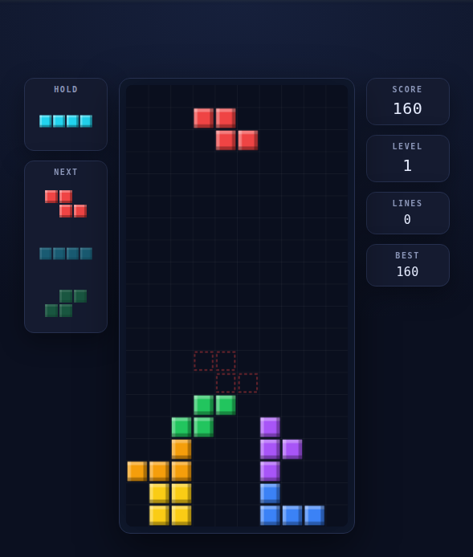

# Tetris

A single-file Tetris game — no dependencies, no build step, works offline.

## ▶ Play it now

**https://laurenthyz.github.io/test2510/**

[](https://laurenthyz.github.io/test2510/)

## Run locally

Just open `index.html` in any modern browser:

```sh
git clone https://github.com/laurentHYZ/test2510.git
cd test2510
xdg-open index.html    # or: open index.html (macOS), start index.html (Windows)
```

## Controls

| Key | Action |
| --- | --- |
| <kbd>←</kbd> <kbd>→</kbd> | Move left / right (hold to auto-repeat) |
| <kbd>↓</kbd> | Soft drop (+1 point per row) |
| <kbd>↑</kbd> / <kbd>X</kbd> | Rotate clockwise |
| <kbd>Z</kbd> / <kbd>Ctrl</kbd> | Rotate counter-clockwise |
| <kbd>Space</kbd> | Hard drop (+2 points per row) |
| <kbd>C</kbd> / <kbd>Shift</kbd> | Hold piece |
| <kbd>P</kbd> / <kbd>Esc</kbd> | Pause |
| <kbd>R</kbd> | Restart |
| <kbd>M</kbd> | Mute / unmute sound |

On touch devices, on-screen buttons appear below the board.

## Features

- 10 × 20 playfield, 7-bag randomizer
- Super Rotation System with full wall-kick tables
- Ghost piece, hold slot, 3-piece next preview
- Lock delay (500 ms, up to 15 resets)
- Guideline scoring: 100 / 300 / 500 / 800 × level, back-to-back Tetris bonus, combos
- Level up every 10 lines, 15-step gravity curve
- Chiptune sound effects synthesized in-browser with the Web Audio API (move, rotate, hold, lock, hard drop, line clear, level up, game over) — no audio files, toggle with the **SOUND** button or <kbd>M</kbd>
- Best score saved in `localStorage`
- Bilingual UI (Simplified Chinese / English) with an **EN / 中文** toggle in the side panel; Chinese is the default, and the choice is remembered in `localStorage`
- Responsive dark UI, no external assets
